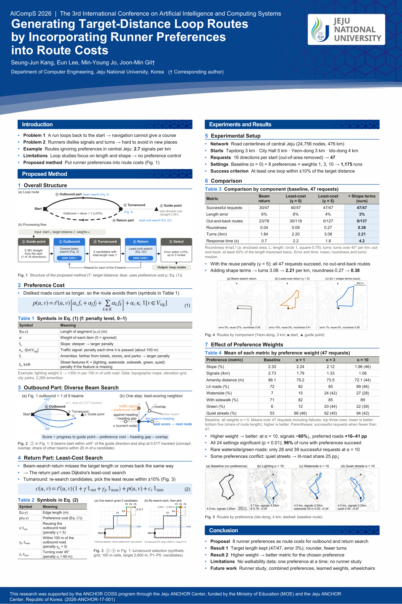
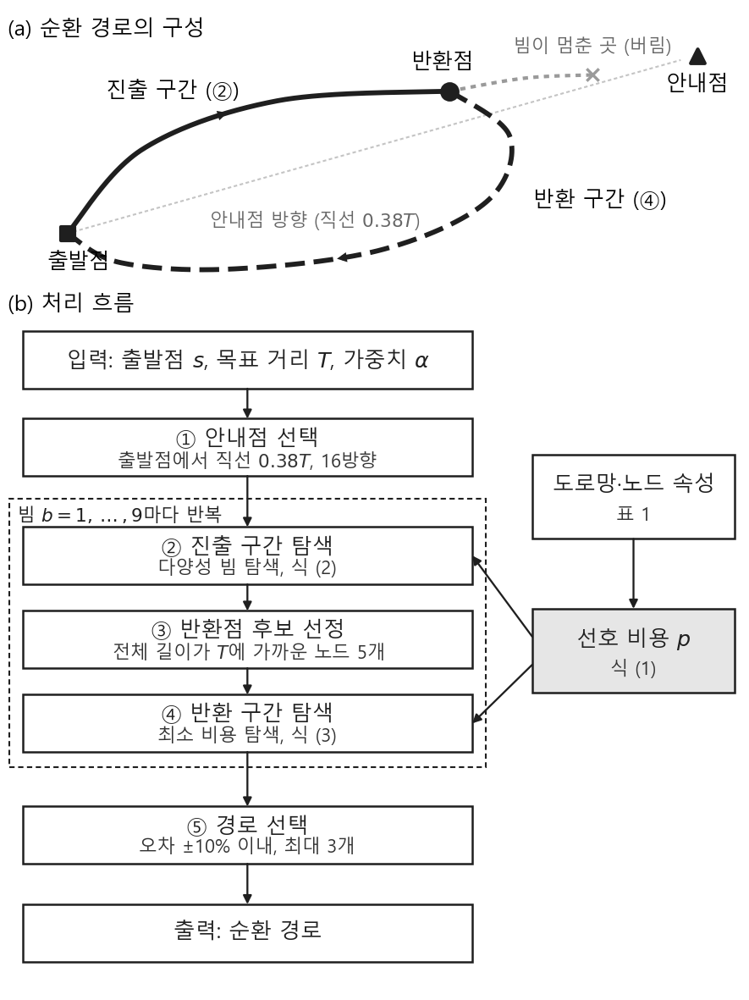

# 러너의 선호를 반영한 목표 거리 순환 경로 생성 (논문·포스터 자료)

강승준·이은·조민영·길준민(교신저자), 제주대학교 컴퓨터공학과

이 저장소에는 2026 한국정보기술학회 추계 종합학술대회 논문 원문과, 그 논문으로 만든 AICompS 2026 포스터(2026-12-02~04, 오사카)가 들어 있다. 발표 준비를 함께 하는 사람이 내용을 파악하고, 각 결과물이 어떤 자료와 코드로 만들어졌는지 따라갈 수 있게 정리했다.

<p align="center"></p>

## 1. 먼저 볼 파일

| 순서 | 파일 | 내용 |
|---|---|---|
| 1 | [포스터/포스터_v2_영어.pdf](포스터/포스터_v2_영어.pdf) | 발표할 포스터 (영어, 최신) |
| 2 | [포스터/포스터_v2_한글.pdf](포스터/포스터_v2_한글.pdf) | 같은 포스터의 한글판 (최신) |
| 3 | [원고/논문_정보기술학회_v5.pdf](원고/논문_정보기술학회_v5.pdf) | 논문 원문 v5 (7쪽, 최신) |

포스터는 논문을 줄인 것이라 수식 번호와 표·그림 번호가 논문과 다르다. 포스터 식 (2)는 논문 식 (3), 포스터 표 3·4는 논문 표 2·3에 해당한다.

## 2. 연구 내용

### 가. 문제

1) 러닝은 목적지 없이 정한 거리를 달려 출발점으로 돌아오는 운동이라, 출발지에서 목적지까지 길을 찾는 길 안내로는 코스를 얻기 어렵다.
2) 낯선 곳의 러너는 오르막과 신호 위치를 모른다. 선호를 반영하지 않은 경로는 제주 도심에서 km당 신호 교차로를 2.7곳 지난다.
3) 기존 고정 길이 순환 경로 연구는 길이와 모양에 초점을 두어 러너마다 다른 선호를 조절하기 어렵다.

### 나. 방법



1) **선호 비용(논문 식 1):** 경사, 신호 교차로, 편의시설, 조명, 물가, 보도, 녹지, 조용한 길 등 여덟 가지 선호를 거리(m) 단위 벌점으로 바꾸고 가중치 α를 곱해 길이에 더한다. 신호 교차로 하나는 대기 30초 동안 3 m/s로 달리는 거리인 약 100 m로 친다. α가 0이면 그 선호는 고려하지 않는다.
2) **진출 구간(다양성 빔 탐색):** 16방향 중 하나로 안내점(출발점에서 직선 0.38T)을 정하고, 빔 9개가 그 방향 ±45° 안으로 퍼져 나아간다. 누적 거리가 0.51T가 되면 멈춘다. T는 목표 거리이다.
3) **반환 구간(최소 비용 탐색, 논문 식 3):** Dijkstra 탐색으로 돌아오는 길을 구한다. 간선 비용에는 길이와 선호 비용 외에 세 가지 벌점이 붙는다.
   - 되밟기 벌점 γ=5: 이미 지난 길
   - 근접 벌점 γ_p=3: 진출 구간에서 100 m 안의 길
   - 꺾임 벌점 60 m: 45°보다 크게 꺾을 때마다

   근접 벌점과 꺾임 벌점을 묶어 '모양 항'이라 부른다.
4) **반환점 선택:** 빔 경로 위에서 전체 길이가 T에 가까운 노드 5개를 후보로 두고, 후보마다 다시 탐색해 오차 ±10% 안에서 되밟은 길이가 가장 짧은 노드를 고른다.
5) **최종 경로:** 빔 점수(0.55)와 다른 경로와 겹치지 않는 정도(0.45)의 합이 큰 순서로 최대 3개를 낸다.

### 다. 실험

1) 도로망: 국토지리정보원 도로중심선으로 만든 제주 도심 그래프(노드 24,756개, 476 km)
2) 출발점: 탑동 3 km, 시청 5 km, 연동 3 km, 이도동 4 km. 출발점마다 16방향을 요청하고 실험 범위 밖으로 나가는 방향을 빼서 요청 47개
3) 설정: 기준(α 모두 0) 1개와 선호 8가지 × 가중치 1, 3, 10의 24개를 더해 모두 25개, 1,175회 실행

### 라. 결과

1) 기준 설정에서 47개 요청이 모두 성공(목표 거리 ±10% 안)했고, 평균 거리 오차는 3%, 왕복형 경로는 0개였다.
2) 모양 항을 더하면 둥근 정도가 0.27에서 0.38로 늘고, km당 꺾임은 3.08에서 2.21로 줄었다.
3) 가중치 10에서 신호 교차로는 km당 2.73곳에서 1.08곳으로 약 60% 줄었고, 선호한 길의 비율은 16~41%p 늘었다. 선호를 켠 1,128회 중 96%가 성공했다.
4) 한계: 도로중심선 그래프는 실제 보행 가능 여부와 공사 구간을 모르고, 선호는 한 번에 하나씩만 켰으며, 실제 러너의 평가는 하지 않았다.

## 3. 만든 과정

### 가. 날짜별 흐름

| 날짜 | 한 일 | 기록 |
|---|---|---|
| 11/8 | 투고처를 한국정보기술학회 추계 학술대회로 정하고, 주제를 '러너 선호를 비용에 반영한 순환 경로'로 잡음 | 인수인계/2026-11-08-handoff.md |
| 11/9 | 자료를 처음부터 다시 받기로 함. 공공데이터·국토정보맵 수치지도 수집, 기존 그래프 점검 | 데이터/수집계획*.md, 실험/수집확인_1109, 데이터진단_1109, 소구역점검_1109 |
| 11/10 | 새 도로 그래프(폭 3 m 미만 제외, 입체 교차 10곳 분리), 1:1,000 지도의 신호등으로 신호 위치 지정, 제주 도심 실험 범위 확정 | 실험/새그래프_1110, 도심실험_1110 |
| 11/10 | 길찾기 서버에 선호 비용 추가, 예비 경로 확인, 1차 본 실험 | 실험/코드수정_1110 |
| 11/10 밤 | '러닝 동선답지 않다'는 검토로 모양 항을 넣고, 조명·물가·보도·녹지·조용한 길 선호를 더해 다시 실험 | 실험/동선개선_1110 |
| 11/10~11 | 원고 v1~v4 작성 | 원고/이전버전, 원고/작업_v4 |
| 11/13 | 교수 의견으로 표 3을 실제 평균값으로 바꾼 v5, 포스터 한글판과 영어판 | 원고/작업_v5, 포스터/ |

날마다 무엇을 왜 정했는지는 [인수인계/](인수인계/)의 날짜별 문서에 있다. 이어서 작업하려고 쓴 메모라 내부 용어가 섞여 있다.

### 나. 결과물이 만들어지는 순서

```
원본 지도·공공데이터 (저장소에는 없음, 5장 참고)
 → 실험/새그래프_1110/ : 도로 그래프, 신호 위치, 편의시설, 고도
 → 실험/코드수정_1110/build_v3_db.py : 로컬 MySQL DB (gildongmu_v3)
 → 길찾기 서버 (팀 코드 + 서버코드_변경/ 패치), 실행은 실험/코드수정_1110/server/start_server_v3*.sh
 → 실험 스크립트가 서버에 경로를 요청
      표 2 : 실험/코드수정_1110/table2_routes.py, 실험/동선개선_1110/table2_shape.py
      표 3 : 실험/동선개선_1110/main_routes2.py·main_routes3.py → 원고/작업_v5/표3_실제값.py
 → 원고/작업_v5/논문_정보기술학회_v5.md (원고 정본)
      → build_pdf.py → PDF
      → 한글본/make_hwp.py → 학회 양식 hwp → 한글본/to_hwpx.py → hwpx
      그림 : 그림_v4/make_figs_v4.py (그림 1·4·5), make_fig_turn.py (그림 2), make_fig_data.py (그림 3)
 → 포스터/_만들기/make_poster.py (한글), make_poster_en.py (영어) → pptx
      → to_pdf.ps1 (PowerPoint로 PDF 내보내기)
```

포스터 v2는 스크립트로 만든 v1을 PowerPoint에서 직접 고친 판이다. 그래서 스크립트를 다시 돌리면 v1이 나온다.

## 4. 폴더 안내

| 폴더 | 내용 |
|---|---|
| [원고/](원고/) | 맨 위가 최신본(v5 pdf·hwp·hwpx). `논문_정보기술학회.hwpx`는 v4이고, `학술대회논문양식_표준형식.hwp`는 학회가 준 빈 양식이다. `작업_v5/`·`작업_v4/`에 원고 md와 만드는 스크립트, `이전버전/`에 v1~v4와 시험본이 있다. |
| [포스터/](포스터/) | 포스터 v1·v2(한글·영어). `_만들기/`에 포스터와 포스터 전용 그림을 만드는 스크립트, 배경, 로고, 수식 그림이 있다. |
| [실험/](실험/) | 날짜·주제별 실험 폴더. 각 폴더의 `*_결과.md`가 요약이고, `.py`는 코드, `.out`·`.log`는 원 출력, `.json`·`.csv`는 결과 자료이다. |
| [데이터/](데이터/) | 자료 수집 계획(1~3판), 러닝 동선 문헌 조사, 공공데이터포털에서 받은 파일 목록 |
| [인수인계/](인수인계/) | 날짜별 작업 기록 |
| [서버코드_변경/](서버코드_변경/) | 길찾기 서버에서 우리가 고친 부분(패치 11개, 6장) |

## 5. 저장소에 넣지 않은 것

1) 원본 지도와 공공데이터(약 3.8 GB): 국토정보맵 연속수치지도와 1:1,000 수치지도, 브이월드 도로중심선, 공공데이터포털 자료. 원본 지도는 외부에 올리지 않기로 했다. 받은 곳과 파일 목록은 데이터/수집계획*.md와 수집기록_공공데이터포털.json에 있다.
2) 항공영상·로드뷰 캡처: 도로 연결과 입체 교차를 확인할 때 쓴 화면이다. 영상의 권리가 제공처에 있다.
3) 그래프·고도 격자 파일(npz·npy·pkl·bin): 원본 지도로 만든 파일이다.
4) 인증키 파일과, 로컬 DB 비밀번호가 그대로 적힌 점검 스크립트 3개
5) 길찾기 서버 전체 코드: 캡스톤1 팀 코드라서 넣지 않았다.

그래서 이 저장소만으로는 실험을 다시 돌릴 수 없다. 원고·포스터 파일과 각 단계의 코드·출력·결과 문서를 보는 용도이다.

## 6. 서버코드_변경

길찾기 서버는 캡스톤1 팀의 6월 실험 버전(커밋 `b25a639`)을 기준점으로 두고, 그 위에 커밋 11개를 더했다. 패치를 순서대로 적용하면(`git am 서버코드_변경/*.patch`) 실험에 쓴 코드가 된다.

| 패치 | 내용 | 논문 |
|---|---|---|
| 01_테스트_컴파일오류_고침 | 기존 테스트의 컴파일 오류 수정 | - |
| 02_귀환계산기_ReturnPlanner | 반환 구간을 최소 비용 탐색으로 구하는 계산기 | 3.4 |
| 03_LOOP_V2_엔진_진입점 | 새 순환 경로 엔진(LOOP_V2), 요청에서 고를 때만 사용 | 3.1~3.4 |
| 04_안내점_실험범위_제한 | 안내점을 실험 범위 안에서만 고름 | 4.1 |
| 05_선호비용_재사용판정 | 선호 비용(경사·신호·편의시설) 추가, 되밟기 판정 수정 | 3.2 식 1 |
| 06_생성자_Autowired | Spring 설정 수정 | - |
| 07_선호상수_주석확정 | 선호 상수(τ, κ_c, λ_p)를 확정값으로 표기 | 3.2 |
| 08_귀환_모양벌점_근접회전 | 반환 구간의 근접·꺾임 벌점(모양 항) | 3.4 식 3 |
| 09_진출_모양값_지그재그측면 | 진출 구간의 모양 값 | 3.3 |
| 10_선호_조명물가 | 조명·물가 선호 | 3.2 표 1 |
| 11_선호_보도녹지조용한길 | 보도·녹지·조용한 길 선호 | 3.2 표 1 |

---

※ 본 과제(결과물)는 교육부와 한국연구재단의 재원으로 지원을 받아 수행된 첨단분야 혁신융합대학사업의 연구결과입니다.
