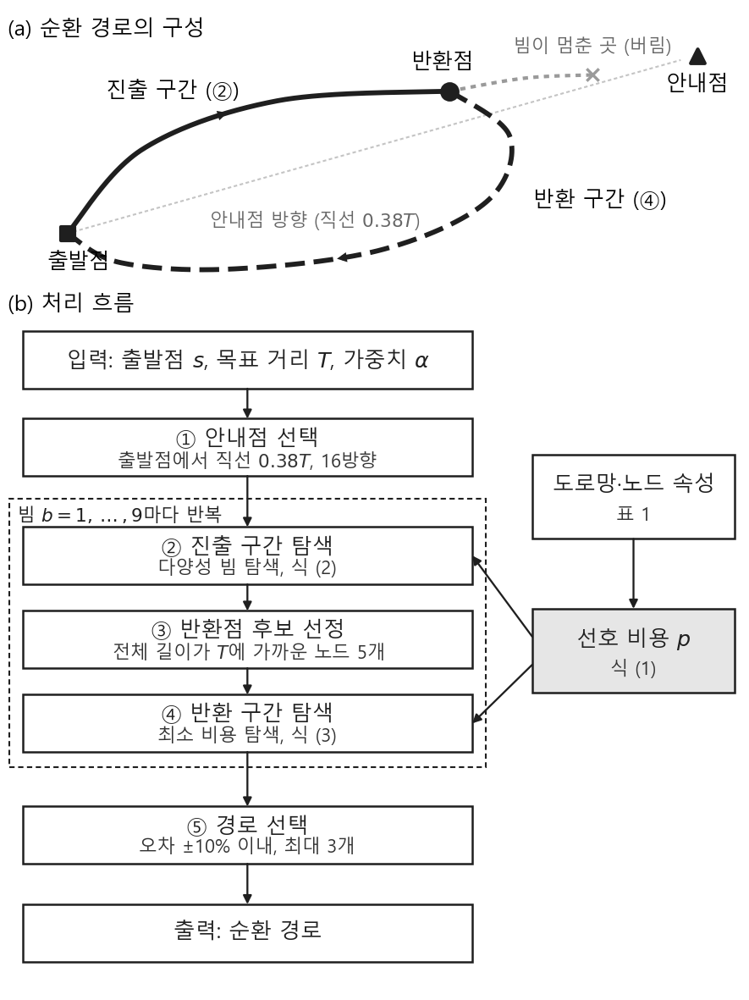
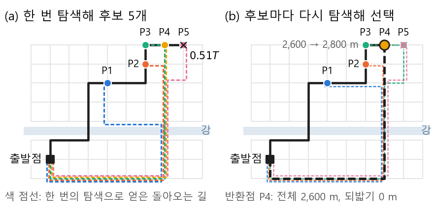
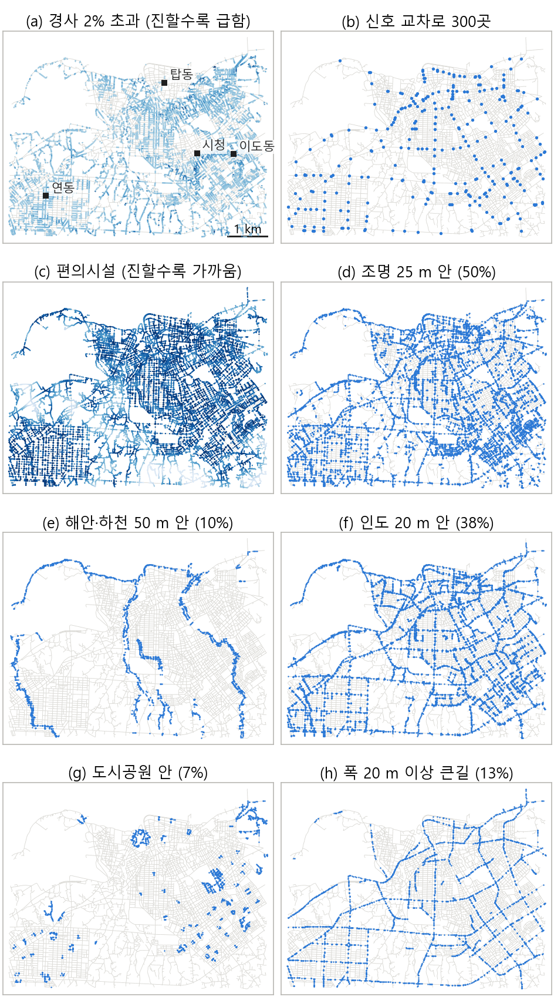
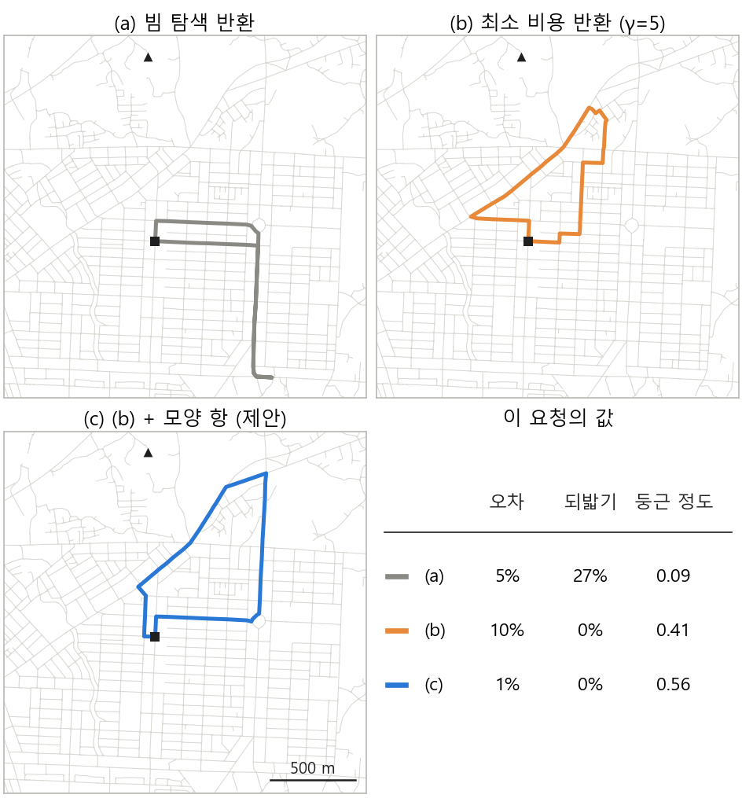
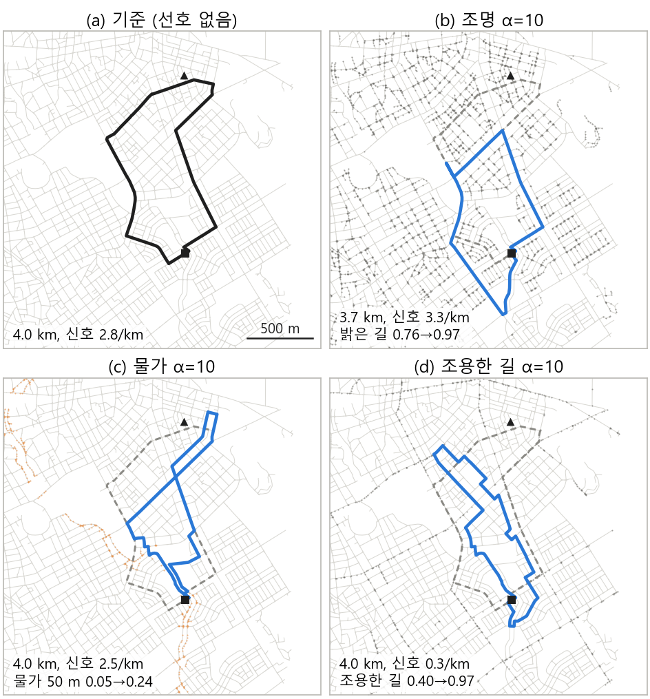

# 러너의 선호를 경로 비용에 반영한 목표 거리 순환 경로 생성

**Generating Target-Distance Loop Routes by Incorporating Runner Preferences into Route Costs**

강승준\*, 이은\*, 조민영\*, 길준민\*\*

Seung-Jun Kang\*, Eun Lee\*, Min-Young Jo\*, Joon-Min Gil\*\*

> 2026 한국정보기술학회 추계 종합학술대회 제출용 초안 v4 (2026-11-11, 6월 원고처럼 그림·표 중심으로 다시 짠 시험판. v3는 그대로 둠).
> ★ 표시는 아직 하지 않은 부분이다. 할 일은 문서 끝 초안 메모에 모았다.

---

## 요 약

러닝은 목적지 없이 정한 거리를 달려 돌아오는 운동이어서 길 안내로는 코스를 얻기 어렵고, 낯선 곳의 러너는 오르막과 신호 위치를 모른다. 본 논문은 경사·신호 교차로·편의시설·조명·물가·보도·녹지·조용한 길에 대한 러너의 선호를 가중치를 둔 경로 비용으로 표현하고, 나가는 길은 다양성 빔 탐색으로, 돌아오는 길은 되밟기·근접·회전 벌점과 선호 비용을 더한 최소 비용 탐색으로 만들어 목표 거리에 맞는 순환 경로를 생성한다. 제주 도심 47개 요청에서 기준 설정은 모두 목표 거리 ±10% 안에 들었고(평균 오차 3%) 왕복형 경로가 없었으며, 모양 항으로 경로의 둥근 정도가 0.27에서 0.38로 늘었다. 선호 가중치를 1, 3, 10으로 키우면 신호 교차로는 최대 약 60% 줄고 선호한 길(밝은 길·물가·녹지·조용한 길 등)의 비율은 최대 41%p 늘었으며, 선호를 켠 요청의 96%가 성공하였다. 끝으로 다른 사용자 유형으로의 확장을 논의한다.

## Abstract

Running is an activity of covering a chosen distance and returning to the start without a destination, so route guidance rarely yields a running course, and runners in unfamiliar places do not know where the hills and traffic signals are. This paper expresses runner preferences for slope, signalized intersections, amenities, lighting, waterside, sidewalks, green space, and quiet streets as weighted route costs, and generates loop routes of a target length: the outbound part by a diverse beam search and the return part by a least-cost search that adds reuse, proximity, and turn penalties to the preference cost. In 47 requests in central Jeju City, every baseline request produced a route within ±10% of the target (mean error 3%) with no out-and-back routes, and the shape terms raised roundness from 0.27 to 0.38. With preference weights of 1, 3, and 10, signalized intersections fell by up to about 60%, the share of preferred streets (lit, waterside, green, quiet, etc.) rose by up to 41 percentage points, and 96% of the requests with preferences succeeded. We also discuss extensions to other user groups.

**Key words**

running route, loop route generation, user preference, beam search, road network

---

## Ⅰ. 서 론

러닝은 목적지 없이 정한 거리를 달려 출발점으로 돌아오는 운동이어서, 출발지에서 목적지까지의 길을 찾는 길 안내로는 코스를 얻기 어렵다. 특히 여행지처럼 낯선 곳에서는 어느 길이 오르막이고 어디서 신호에 걸리는지 알 수 없는데, 러너는 신호 대기와 잦은 회전을 달리기의 흐름을 끊는 요인으로 꼽는다[1]. 연 1,300만 명이 찾는 제주[2]의 도심에서도 선호를 반영하지 않은 경로는 km당 신호 교차로를 2.7곳, 5 km면 약 14곳 지난다.

고정 길이 순환 경로 연구[3][4]는 길이와 모양에 초점을 두어 러너마다 다른 선호를 조절하기 어렵다. 이에 본 논문은 낯선 곳의 러너를 위한 순환 경로 생성 방법을 제안한다. 핵심은 (1) 경사·신호 교차로·조명·물가 등 여덟 가지 선호를 거리 단위의 벌점(예: 신호 하나에 약 100 m)으로 환산한 선호 비용, (2) 이 비용을 나가는 길의 다양성 빔 탐색과 돌아오는 길의 최소 비용 탐색에 함께 쓰는 생성 구조, (3) 나간 길 근처와 잦은 회전에 벌점을 주어 경로를 둥글고 덜 꺾이게 하는 모양 항이다. 제주 도심 실험에서 요청의 96%가 목표 거리 ±10% 안에 들었고, 가중치를 높일수록 경로가 러너가 원하는 길로 바뀌었다.

## Ⅱ. 관련 연구

최단 경로 알고리즘[5]과 대규모 도로망 탐색 기법[6]은 단일 비용을 최소화하고, 쾌적한 길[7][8]이나 안전한 길[9]을 찾는 연구는 여러 기준을 결합하지만 목적지를 전제로 한다. 순환 경로는 Gemsa 등[3]이 주변 환경, 원형에 가까운 모양, 회전 수를 기준으로 조깅 경로 문제를 정식화했고, Lewis와 Corcoran[4]은 고정 길이 순환 경로를 빠르게 계산하였다. 러너 선호는 Hänsel 등[1]이 설문과 면접으로 조사해 경로 추천에 썼고, Trail Router[10]는 녹지와 경사를 반영한 지정 거리 경로를 제공한다.

여러 경로를 제시하는 방법으로는 겹침을 제한한 k개 경로 탐색[11]과 다양성 빔 탐색[12]이 있다. 본 논문은 다양성 빔 탐색을 나가는 구간에 적용하되, 선호 비용을 오가는 길 모두에 반영하는 데 초점을 둔다.

## Ⅲ. 제안 방법

### 3.1 전체 구조

도로망은 노드 $V$와 간선 $E$의 그래프이고, 간선 $(u,v)$의 길이는 $\ell(u,v)$이다. 순환 경로는 돌아서는 지점인 반환점을 기준으로, 출발점에서 반환점까지의 진출 구간과 반환점에서 출발점까지의 반환 구간으로 나뉜다(그림 1).

> **그림 1. 제안 방법의 구조: (a) 순환 경로의 구성, (b) 처리 흐름**
> **Fig. 1. Structure of the proposed method**

### 3.2 선호 비용

선호 항목은 경사($s$), 신호 교차로($c$), 편의시설($f$)과, 러너가 선호한다고 조사된[13][1] 길의 성질 $k\in K$=\{조명, 물가, 보도, 녹지, 조용한 길\}이다. 항목마다 반영 강도를 가중치 $\alpha\ge 0$으로 두며, 0이면 그 항목을 고려하지 않는다. 각 항목은 거리 단위(m)의 벌점으로 환산하고 가중치를 곱해 길이에 더한다. 예를 들어 신호 교차로 하나는 대기 약 30초 동안 3 m/s로 달릴 수 있는 거리인 약 100 m로 환산한다. 구간 $(u,v)$의 선호 비용 $p(u,v)$는 수식 (1)과 같고, 각 항은 표 1과 같다.

$$\begin{aligned}p(u,v)={}&\ell(u,v)\Bigl[\alpha_s f_s+\alpha_f f_f+\sum_{k\in K}\alpha_k f_k\Bigr]\\&+\alpha_c\,\kappa_c\,\mathbb{1}[v\in V_{sig}]\end{aligned} \tag{1}$$

$V_{sig}$는 신호 교차로의 집합이고, 예를 들어 $\alpha_k=3$이면 성질 $k$가 없는 100 m에 300 m를 더한다.

**표 1. 선호 항목의 정의와 자료**
**Table 1. Definitions and data sources of preference terms**

| 항목 | 정의 (괄호: 그 성질을 가진 노드 비율) | 자료 |
|---|---|---|
| 경사 $f_s$ | $\min(1,\max(0,\lvert g\rvert-2)/20)$, $g$는 구간 경사(%) | 등고선·표고점으로 만든 10 m 고도 격자 |
| 신호 교차로 | 지날 때마다 $\kappa_c\approx100$ m (대기 30초 × 3 m/s), 300곳 | 1:1,000 수치지형도 신호등 1,289개를 교차 노드에 지정 |
| 편의시설 $f_f$ | 두 끝 노드의 $\min(d,500)/500$ 평균, $d$는 최근접 시설까지 직선거리(m) | 화장실·편의점·공원 2,289곳 |
| 길의 성질 $f_k$ | 두 끝 노드 중 성질이 없는 비율(0, 0.5, 1). 성질: 조명 25 m 안(50%), 해안·하천 50 m 안(10%), 인도 20 m 안(38%), 도시공원 안(7%), 폭 20 m 미만 도로(87%) | 1:1,000 조명 12,117개, 연속수치지형도 해안선·하천·인도·도로 폭, 제주시 도시공원 82곳 |

### 3.3 진출 구간: 다양성 빔 탐색

안내점은 출발점을 기준으로 16방향 중 무작위로 고른 한 방향에 직선 약 $0.38T$ 떨어진 도로 노드로, 나갈 방향만 정하며 지나지 않아도 된다. 빔 9개는 안내점 방향을 기준으로 $-45°$~$+45°$까지 퍼지도록 서로 다른 방위를 받고, 각 빔은 현재 노드 $u$의 이웃 $c$를 수식 (2)의 점수로 확장한다.

$$S(c\mid b)=A(u,c)-\lambda_p\,\frac{p(u,c)}{\ell_0}-\lambda_1\frac{\Delta_b(c)}{180°}-\lambda_2 D(c) \tag{2}$$

$A$는 안내점 쪽 진행을 북돋우고 지그재그·재사용에 벌점을 주는 기하 점수, $\Delta_b$는 빔의 방위와 $u\to c$ 방향의 차이, $D$는 후보 반경 20 m 안을 지난 다른 빔의 비율이다($\lambda_1=0.55$, $\lambda_2=0.35$). 선호 비용은 기준 간격 $\ell_0=15$ m로 나눠 점수 단위로 바꾼다($\lambda_p=1$). 매 단계 빔마다 점수 상위 3개 후보를 돌아가며 뽑아 빔 9개를 유지하고, 방문한 노드·막다른 길·연속 급회전은 제외한다. 빔은 누적 거리가 $0.51T$에 이르면 멈춘다(5 km 요청은 $0.48T$ 이상이면서 출발점에서 직선 2 km 이상 떨어져도 멈춘다).

### 3.4 반환 구간: 최소 비용 탐색

반환 구간도 빔 탐색으로 찾으면 목표 거리를 맞추지 못하거나 왔던 길을 되밟기 쉽다(4.2절). 그래서 반환 구간은 최소 비용 탐색으로 구하며, 빔이 나아간 경로 $P_{out}$의 $i$번째 노드를 반환점으로 할 때 간선 비용은 수식 (3)이다.

$$\begin{aligned}c_i(u,v)={}&\ell(u,v)\bigl(1+\gamma\,\mathbb{1}_{out}+\gamma_p\,\mathbb{1}_{near}\bigr)\\&+p(u,v)+c_t\,\mathbb{1}_{turn}\end{aligned} \tag{3}$$

첫째, $\mathbb{1}_{out}$은 이미 지난 간선에 벌점 $\gamma=5$를 주어 되밟기를 막되, 금지하지는 않아 막다른 길에서도 돌아올 수 있다. 둘째, $\mathbb{1}_{near}$는 진출 구간에서 도로 거리 $r=100$ m 안의 간선에 벌점 $\gamma_p=3$을 주어 진출 구간 바로 옆으로 돌아오는 가는 고리를 막는다. 셋째, $\mathbb{1}_{turn}$은 45°보다 크게 꺾을 때마다 $c_t=60$ m를 더해 계단식 경로를 줄인다. $\gamma_p\,\mathbb{1}_{near}$와 $c_t\,\mathbb{1}_{turn}$은 둥글고 덜 꺾이는 러닝 경로의 기준[3][1]을 옮긴 것으로, 이 둘을 모양 항이라 한다. $p$는 진출 구간과 같은 선호 비용이어서, 반환 구간은 가장 짧은 길이 아니라 선호와 모양을 반영해 비용이 가장 작은 길이 된다.

반환점은 빔이 $0.51T$까지 나아가 멈춘 뒤 그 경로 위에서 고르고, 반환점 뒤로 나아간 부분은 버린다(그림 1). 출발점에서 Dijkstra 탐색[5]을 한 번 하면 경로 위 모든 노드까지 비용이 가장 작은 길을 얻고, 이를 뒤집으면 각 노드의 돌아오는 길이 된다. 나아간 길이와의 합이 $T$에 가장 가까운 노드 5개를 후보로 남긴다. 이 탐색은 경로 전체를 벌점 대상으로 한 근사이므로, 후보마다 그 노드까지 지난 길만 벌점 대상으로 다시 탐색해 오차 ±10% 안에서 되밟은 길이가 가장 짧은 노드를 반환점으로 정한다(그림 2).

> **그림 2. 반환점 선택의 예 (가상 도로, 한 칸 100 m, 목표 2,600 m, P1~P5: 반환점 후보와 각각의 돌아오는 길, (b)의 수치는 1단계 길이 → 다시 잰 길이)**
> **Fig. 2. Example of turnaround selection (synthetic grid)**

최종 경로는 오차 ±10% 안의 빔별 순환 경로 중 정규화한 빔 점수(0.55)와 이미 고른 경로와 겹치지 않는 정도(0.45)의 합이 큰 순서로 최대 3개를 고른다.

## Ⅳ. 실험 및 결과

### 4.1 실험 설정

도로망은 국토지리정보원 연속수치지형도의 제주 도로중심선에서 폭 3 m 미만 도로를 빼고 영상으로 확인한 입체 교차 10곳의 연결을 끊어, 신호 자료가 있는 제주 도심을 짧은 간선으로 나누었다(노드 24,756개, 간선 평균 17.7 m, 476 km, 그림 3). 출발점은 탑동(3 km), 도심(5 km), 연동(3 km), 이도동(4 km)이다. 실험에서는 방향에 따른 치우침이 없도록 무작위 대신 출발점마다 16방향을 하나씩 모두 요청하되, 안내점이 실험 범위(그림 3의 지도) 밖에 떨어지는 방향은 빼서 요청 47개(탑동 11, 도심 15, 연동 10, 이도동 11)를 만들었다. 이를 기준 설정과 선호 설정 24개(선호 8가지 × 가중치 1, 3, 10)에 적용해 1,175회 실행하였다. 기준 설정은 선호 가중치 $\alpha$를 모두 0으로 둔 설정이다. 모양 항의 값($r$, $\gamma_p$, $c_t$)은 모든 설정에 같게 두었으며, 본 실험과 겹치지 않는 예비 요청 12개에서 결과를 보기 전에 정한 규칙(12개 모두 성공, 평균 거리 오차 5% 이하인 값 중 둥근 정도가 가장 큰 값)으로 골랐다.

> **그림 3. 실험 도로망과 선호 항목별 노드 속성 (제주 도심 약 6.8 × 5.3 km, 회색: 도로망, 파랑: 해당 항목, ■ 출발점)**
> **Fig. 3. Road network and node attributes used in the experiment**

성공 요청은 길이가 목표 거리의 ±10% 안인 순환 경로를 1개 이상 만든 요청이고, 실패 요청은 그런 경로 없이 길이가 벗어나거나 왕복형인 경로만 만든 요청이다. 왕복형은 나간 길로 되돌아오는 경로로, 두 번째로 지난 간선의 길이가 경로 길이의 40% 이상인 경로이다(완전한 왕복은 50%). 둥근 정도는 $4\pi a/L^2$($a$는 고리가 둘러싼 넓이, $L$은 경로 길이, 클수록 둥글며 원 1, 정사각형 0.79), 꺾임 수는 작은 굴곡을 빼려고 경로를 10 m 허용 오차로 단순화(Douglas–Peucker)한 뒤 45°보다 크게 꺾인 km당 횟수(클수록 지그재그)이다. 경사는 구간 경사 절댓값의 길이 가중 평균, 신호 교차로는 지난 신호 교차로 수를 경로 길이(km)로 나눈 값, 편의시설 거리는 표 1의 $d$(500 m 상한)의 길이 가중 평균이며, 성질별 길이 비율은 경로에서 길의 성질(조명·물가·보도·녹지·조용한 길, 표 1)을 가진 길이 차지하는 길이의 비율이며, 두 끝 노드가 모두 그 성질인 간선만 센다. 요청 하나는 경로를 최대 3개 내므로 그 지표 평균을 요청 값으로 쓰며, 실패 요청도 포함한다. 선호의 효과는 같은 요청에서 기준 설정과의 차이로 보고, 그 차이가 0과 다른지를 윌콕슨 부호순위 검정(양측)으로 확인한다.

> **그림 4. 구성 요소별 경로의 예 (연동 3 km, 오른쪽 아래 표는 이 요청의 값, ■ 출발점, ▲ 안내점)**
> **Fig. 4. Example routes by component (Yeon-dong, 3 km)**

### 4.2 구성 요소별 비교

**표 2. 구성 요소별 비교 (기준 설정, 요청 47개)**
**Table 2. Comparison by component (baseline setting, 47 requests)**

| 지표 | 빔 탐색 반환 | 최소 비용 ($\gamma$=0) | 최소 비용 ($\gamma$=5) | + 모양 항 (제안) |
|---|:---:|:---:|:---:|:---:|
| 성공 요청 | 30/47 | 40/47 | 47/47 | 47/47 |
| 거리 오차 | 6% | 6% | 4% | 3% |
| 왕복형 경로 | 23/78 | 30/118 | 0/127 | 0/137 |
| 경로 수 | 1.66 | 2.51 | 2.70 | 2.91 |
| 둥근 정도 | 0.04 | 0.09 | 0.27 | 0.38 |
| 꺾임 수 (/km) | 1.84 | 2.20 | 3.08 | 2.21 |
| 응답 (s) | 0.7 | 2.2 | 1.8 | 4.2 |

주: 경로 수는 요청당 평균, 왕복형은 전체 경로 중 개수, 거리 오차와 응답 시간은 평균, 둥근 정도와 꺾임 수는 중앙값이다. '빔 탐색 반환'은 반환 구간도 빔으로 찾는 이전 방식으로, 선호 비용을 지원하지 않아 기존 엔진의 점수로 탐색하였다.

표 2는 왼쪽부터 반환 구간을 빔 탐색에서 최소 비용 탐색으로 바꾸고 되밟기 벌점($\gamma=5$)과 모양 항을 차례로 더한 결과이다. $\gamma=5$부터 47개 요청이 모두 성공하였고(빔 탐색 반환 30개, $\gamma=0$은 40개), $\gamma=0$에서 경로의 25%였던 왕복형도 없어졌다. 꺾임 수는 $\gamma=5$에서 3.08로 늘었으나(그림 4(b)) 모양 항을 더하면 2.21로 줄고 둥근 정도는 0.27에서 0.38로 늘었으며(그림 4(c)), 응답 시간은 4.2초로 늘었다. 빔 탐색 반환은 꺾임 수가 1.84로 가장 적지만 둥근 정도도 0.04로 가장 낮았다.

### 4.3 선호 가중치에 따른 변화

**표 3. 선호 가중치별 해당 지표 변화 (요청 47개씩)**
**Table 3. Change of each metric by preference weight**

| 선호 (지표) | 기준 값 | $\alpha$=1 | $\alpha$=3 | $\alpha$=10 |
|---|:---:|:---:|:---:|:---:|
| 경사 (%) | 2.33 | −0.09 | −0.21 | −0.37 (46) |
| 신호 교차로 (개/km) | 2.73 | −0.94 | −1.40 | −1.65 |
| 편의시설 거리 (m) | 86.1 | −6.9 | −12.6 | −14.0 (44) |
| 조명 (길이 비율) | 0.72 | +0.10 | +0.13 | +0.17 (46) |
| 물가 (길이 비율) | 0.07 | +0.09 | +0.17 (42) | +0.20 (28) |
| 보도 (길이 비율) | 0.71 | +0.11 | +0.15 | +0.19 |
| 녹지 (길이 비율) | 0.06 | +0.06 | +0.14 (44) | +0.16 (39) |
| 조용한 길 (길이 비율) | 0.53 | +0.33 (46) | +0.39 (45) | +0.41 (42) |

주: α 열은 기준 대비 요청별 차이의 평균(실패 요청 포함 47개)이다. 위 세 행은 −, 아래 다섯 행은 +가 나아진 쪽이며, 괄호는 성공 요청이 47개 미만일 때의 수이다.

> **그림 5. 선호에 따른 경로의 예 (이도동 4 km, 점선: 기준 경로, 회색 점: (b) 조명이 없는 곳·(d) 폭 20 m 이상 큰길, 주황 점: 물가 50 m 안)**
> **Fig. 5. Example routes by preference (Ido-dong, 4 km)**

표 3은 같은 요청에서 한 가지 선호만 1, 3, 10으로 둔 결과이다. 첫째, 가중치를 키울수록 해당 지표가 나아져 $\alpha=10$에서 신호 교차로는 기준 평균의 약 60%, 경사와 편의시설 거리는 16% 줄고, 성질별 길이 비율은 16~41%p 늘었다. 24개 설정 모두 $p<0.01$이었고, Bonferroni 보정 뒤에도 경사 $\alpha=1$을 뺀 23개가 $p<0.05$였다. 둘째, 47개 요청에 24개 설정을 적용한 1,128회 중 1,080회(96%)가 성공하였다. 다만 노드의 10%와 7%에만 있는 물가와 녹지는 $\alpha=10$에서 성공 요청이 47개 중 28개와 39개였다. 셋째, 일부 선호는 서로 부딪쳤다. 표 3에 없는 다른 지표로 보면 $\alpha=10$에서 조명은 신호 교차로를 km당 0.47곳 늘렸고, 조용한 길은 신호를 1.82곳 줄였지만 조명 길이 비율을 25%p 낮췄다(그림 5(b), (d)). 실험 도로망에서 신호 교차로의 57%는 노드의 13%인 폭 20 m 이상 큰길에 있고, 큰길 노드는 97%가 조명, 98%가 인도 가까이에 있다(그림 3(b), (d), (f), (h)).

## Ⅴ. 결 론

본 논문은 낯선 곳의 러너를 위해 여덟 가지 선호를 가중치를 둔 경로 비용으로 표현하고, 진출 구간의 다양성 빔 탐색과 반환 구간의 최소 비용 탐색에 함께 써서 목표 거리 순환 경로를 생성하는 방법을 제안하였다. 제주 도심 실험에서 경로는 목표 거리를 지켰고, 모양 항으로 더 둥글고 덜 꺾였으며, 가중치를 높일수록 설정한 선호의 지표가 나아졌다. 다만 도로중심선 그래프는 실제 보행 가능 여부와 공사 구간을 반영하지 못하고, 녹지와 조용한 길은 공원 면적과 도로 폭으로 어림하였으며, 선호는 하나씩만 켰고 실제 러너의 평가는 하지 않았다. 향후 (1) 러너 평가, (2) 여러 선호의 조합과 기존 방법과의 비교, (3) 올레길·그늘 등 자료 추가와 러너 기록에서의 가중치 학습, (4) 휠체어·유모차 이용자로의 확장을 다룰 계획이다.

## 참 고 문 헌

[1] K. Hänsel et al., "The experience of running: Recommending routes using sensory mapping in urban environments", International Journal of Human-Computer Studies, vol. 201, 103512, 2025.

[2] 제주특별자치도관광협회, "관광객 입도 현황(2024년)", 2025.

[3] A. Gemsa, T. Pajor, D. Wagner, and T. Zündorf, "Efficient computation of jogging routes", Experimental Algorithms (SEA 2013), LNCS, vol. 7933, pp. 272-283, 2013.

[4] R. Lewis and P. Corcoran, "Fast algorithms for computing fixed-length round trips in real-world street networks", SN Computer Science, vol. 5, no. 7, 868, 2024.

[5] E. W. Dijkstra, "A note on two problems in connexion with graphs", Numerische Mathematik, vol. 1, no. 1, pp. 269-271, 1959.

[6] H. Bast et al., "Route planning in transportation networks", Algorithm Engineering, LNCS, vol. 9220, pp. 19-80, 2016.

[7] D. Quercia, R. Schifanella, and L. M. Aiello, "The shortest path to happiness: Recommending beautiful, quiet, and happy routes in the city", Proc. 25th ACM Conf. on Hypertext and Social Media, pp. 116-125, 2014.

[8] T. Novack, Z. Wang, and A. Zipf, "A system for generating customized pleasant pedestrian routes based on OpenStreetMap data", Sensors, vol. 18, no. 11, 3794, 2018.

[9] R. Sarraf and M. P. McGuire, "Integration and comparison of multi-criteria decision making methods in safe route planner", Expert Systems with Applications, vol. 154, 113399, 2020.

[10] Trail Router, "Trail Router: Running Route Generator", https://trailrouter.com

[11] T. Chondrogiannis, P. Bouros, J. Gamper, U. Leser, and D. B. Blumenthal, "Finding k-shortest paths with limited overlap", The VLDB Journal, vol. 29, no. 5, pp. 1023-1047, 2020.

[12] A. K. Vijayakumar et al., "Diverse beam search for improved description of complex scenes", Proc. AAAI Conf. on Artificial Intelligence, vol. 32, no. 1, 2018.

[13] N. Schuurman, L. Rosenkrantz, and S. A. Lear, "Environmental preferences and concerns of recreational road runners", International Journal of Environmental Research and Public Health, vol. 18, no. 12, 6268, 2021.

---

\*제주대학교 컴퓨터공학과, {wind5973, leeeun2022, tnssid}@stu.jejunu.ac.kr
\*\*제주대학교 컴퓨터공학과(교신저자), jmgil@jejunu.ac.kr

※ 본 과제(결과물)는 교육부와 한국연구재단의 재원으로 지원을 받아 수행된 첨단분야 혁신융합대학사업의 연구결과입니다.

---

## 초안 메모 (제출 전 삭제)

- v4는 6월 원고(`../../데이터사이언스학회/06_받은자료/이전_논문본/20260609-논문.docx`)의 장점(기여 번호, 한계→해결, 수식 항별 설명, 구성 요소별 비교, 동선 그림, 번호 붙인 향후 과제)을 따라 v3를 다시 짠 시험판이다. 목표 3~4쪽(사용자 11/11).
- 그림은 `그림_v4/make_figs_v4.py`로 만든다. 그림 1 흐름도, 그림 4 구성 요소별 경로(연동, 중앙값 요청), 그림 5 선호별 경로(이도, 중앙값 요청). 그림 3 실험 자료 지도는 `그림_v4/make_fig_data.py`(로컬 DB와 노드속성_v3c.csv만 읽음). 그림 2 반환점 선택 예시는 `그림_v4/make_fig_turn.py`(가상 바둑판, 예시는 `v4_검토/find_toy.py`로 고름).
- v3에서 바뀐 것: 서론을 문제→한계→핵심 (1)(2)(3)→결과로, 쾌적·안전 경로 인용은 Ⅱ장으로. 3.1 문제 정의와 구조 합침, 3.5 최종 선택은 3.4 끝 한 문장. 4.1·4.2 합침. 표 3은 행렬형. 4.4는 첫째·둘째·셋째. 결론에 번호 붙인 향후 과제.
- 남은 확인: [JEJU] 출처, [3] 원문.
